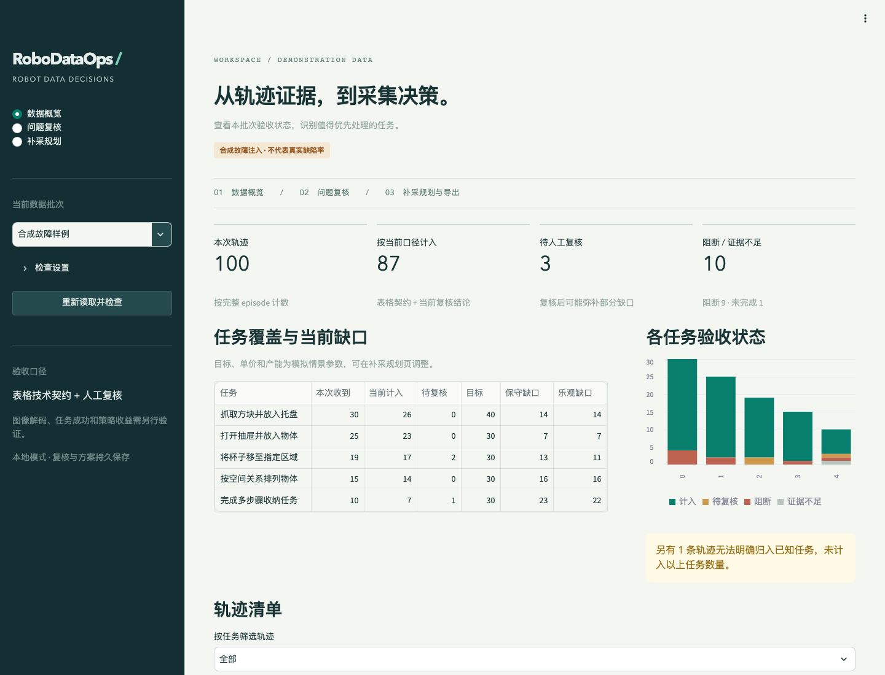
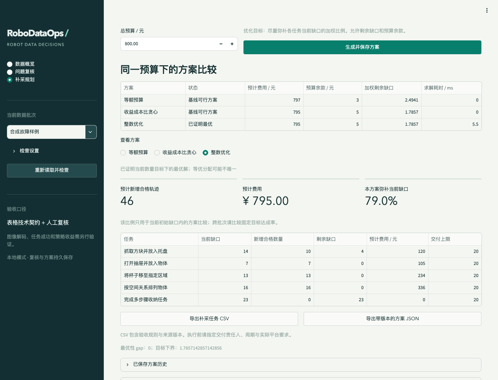

# RoboDataOps

**具身数据质检与补采决策工作台**  
Audit robot demonstrations, review evidence, and plan collection under budget constraints.

面向具身数据 PM、运营与审核人员：判断一批轨迹如何处理、各任务还缺多少，以及下一笔预算如何分配。首版包含三个页面和共享同一核心逻辑的 CLI，可完全离线体验，无需 API Key。

[实际验证结果](reports/validation.md) · [产品规格](docs/PRD.md) · [核心架构](docs/architecture.md) · [开源与个人贡献](docs/contributions.md)



## 启动

需要 Python 3.12 和 [uv](https://docs.astral.sh/uv/)。在仓库根目录运行：

```bash
UV_CACHE_DIR=.cache/uv uv sync --frozen
./script/run.sh
```

打开 [本地工作台](http://127.0.0.1:8501)。应用只监听本机，默认把复核和计划保存在 `var/workbench.duckdb`；重新打开仍可查看历史。不要同时从多个进程打开同一个可写数据库。本地服务支持同一进程的多个浏览器会话，回流登记串行去重。

公开演示时使用会话隔离模式：

```bash
ROBODATAOPS_DEMO_MODE=1 ./script/run.sh
```

演示模式中的人工结论与计划只保留在当前会话。默认未配置公网发布、账号和权限系统。

## 五分钟体验

1. **数据概览**：打开“合成故障样例”，查看轨迹状态、保守/乐观缺口及未知任务。
2. **问题复核**：查看 EP 0007 的非有限动作证据；再查看 EP 0064 的低运动信号，填写理由后驳回。返回概览，当前计入数量随复核变化。
3. **补采规划**：调整目标、合格单价、产能与权重；输入预算，生成均分、贪心和整数优化三种方案，导出 CSV 与完整 JSON。
4. **真实公开数据**：切换“LIBERO 公开样本”。仓库内附约 5 MB 的 100 条轨迹分析缓存，无需现场下载。
5. **回流验收**：在已保存方案历史中，选择同一来源的到货目录，按原平台和规则核对；原批次和已登记轨迹不会重复计功。

CSV 是待确认的采集任务草稿，包含来源版本、平台、规则配置及数据契约。执行前需指定责任人、周期、动作单位与控制模式。回流表 `outstanding` 表示**原计划尚未交付量**；若要更新全部任务覆盖，请导入包含原始与新增数据的累计快照，当前版本不自动合并原始文件。

## 已实现

| 能力 | 当前实现 |
|---|---|
| v3 导入 | 依据元数据恢复共享 Parquet 中的完整 episode；严格校验契约、整数映射与 checksum |
| 可解释质检 | 字段、dtype、shape、NaN/Inf、索引、长度、全局边界、时间戳及任务映射；短轨迹/低运动仅触发复核 |
| 人工复核 | 确认、驳回、暂缓、理由与追加历史；阻断、未检查、待复核按明确优先级归约 |
| 覆盖分析 | 每条轨迹先归约为唯一状态，再用 DuckDB SQL 聚合，避免多告警重复扣数 |
| 补采规划 | SciPy MILP、均分、收益成本比贪心；金额按分，整数交付，独立重算可行性 |
| 方案追踪 | 保存数据、规则、验收、目标和业务参数快照，后续修改不改变旧方案 |
| 到货核对 | 原契约一致性校验、原批次排除、历史到货去重、同进程并发串行处理 |
| 验证 | 规则与合法边界回归、独立枚举 oracle、CLI、AppTest、真实浏览器桌面和手机检查 |



## 数据来源与结论边界

| 样本 | 用途 | 标记 |
|---|---|---|
| `data/demo` | 100 条自建轨迹，13 个受控案例，共产生 14 项发现 | 合成故障注入 |
| 干净合成对照 | 验证合法轨迹和 episode 时间重置不会误报 | 合成数据 |
| `data/public_sample` | `lerobot/libero` 固定版本中 5 个任务、100 条完整轨迹 | 公开仿真示教 |

公开数据 revision：`a1aaacb7f6cd6ee5fb43120f673cebb0cfea7dd4`。分析缓存保留原始 metadata/shards 和选取 manifest，**不是经过重新索引的独立训练数据集**。未下载或检查视频。

当前公开样本在本规则配置下为零发现，不能解释为完整数据无缺陷。合成故障结果不能代表真实缺陷率。默认目标、报价、产能和权重均为模拟业务输入；数量目标改善不代表机器人成功率提升。独立人工标注、真实用户对照和训练 rollout 尚未开展。

来源与许可：[LeRobot 数据集](https://huggingface.co/datasets/lerobot/libero)、[固定提交](https://huggingface.co/datasets/lerobot/libero/commit/a1aaacb7f6cd6ee5fb43120f673cebb0cfea7dd4)、[格式文档](https://huggingface.co/docs/lerobot/lerobot-dataset-v3)。代码采用 MIT；公开数据卡声明 Apache-2.0，归属与许可证副本见 `data/public_sample/NOTICE.md`。

## 复现与 CLI

```bash
# 回归、lint 和覆盖率
UV_CACHE_DIR=.cache/uv uv run --frozen ruff check src app.py tests script
UV_CACHE_DIR=.cache/uv uv run --frozen pytest -q --cov=robodataops

# 质检与带版本的规划输出
UV_CACHE_DIR=.cache/uv uv run --frozen robodataops audit --config configs/demo.json
UV_CACHE_DIR=.cache/uv uv run --frozen robodataops plan --budget 800.00

# 离线核对随仓库附带的真实样本
UV_CACHE_DIR=.cache/uv uv run --frozen robodataops audit --source data/public_sample --output reports/libero-audit.json

# 重新获取固定公开源，不下载视频
HF_HUB_DISABLE_XET=1 UV_CACHE_DIR=.cache/uv uv run --frozen robodataops fetch-libero --tasks 5 --per-task 20

# 重跑独立枚举、合成数据与公开样本验证报告
UV_CACHE_DIR=.cache/uv uv run --frozen python -m robodataops.validation
```

该固定版本的 episode metadata 未直接提供任务字段。获取器会下载并扫描低维表格，用实际 `task_index` 建立映射后分层抽样，代价高于仅取 100 条文件；视频仍排除。源数据只读，改变抽样配置会生成新的 manifest。

可选浏览器复现：启动应用后，在已安装 Playwright 与 Chromium 的 Python 环境执行 `python3 script/browser_smoke.py`。结果见 `reports/browser-smoke.json`；此工具不属于应用的运行依赖。

## 阅读核心实现

- [quality.py](src/robodataops/quality.py)：按 episode 生成证据，技术阻断与人工复核信号分开。
- [coverage.sql](src/robodataops/sql/coverage.sql)：唯一轨迹状态、任务聚合和缺口口径。
- [planning.py](src/robodataops/planning.py)：预算模型、基线、求解状态和独立约束核对。
- [delivery.py](src/robodataops/delivery.py)：原契约核对与到货去重。
- [tests](tests)：包括任务映射、非法元数据、超时、多最优解、平台变更和并发重复到货反例。

后续真实验证按 [用户测试协议](docs/usability-protocol.md) 与 [下一阶段](docs/NEXT_STEPS.md) 执行。项目中的待测部分不填入虚构的客户、访谈、ROI 或策略结果。
